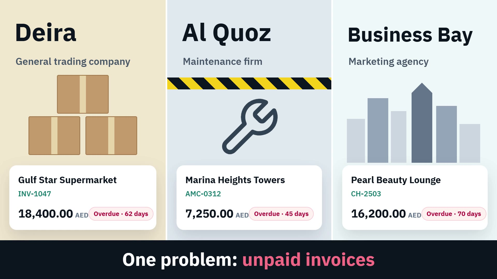

<div align="center">

# تحصيلي · Tahselly

**Invoice follow-up and payment reminders for UAE businesses.**
Import your invoices from Excel, remind clients automatically by email and WhatsApp, and see what is due, overdue and collected — in Arabic or English.




[English promo](public/videos/tahselly-promo-en.mp4) · [Arabic promo](public/videos/tahselly-promo-ar.mp4) · [Arabic tutorial](public/videos/tahselly-tutorial-ar.mp4)

</div>

---

## Contents

- [What it does](#what-it-does)
- [Roles and dashboards](#roles-and-dashboards)
- [Plans and billing](#plans-and-billing)
- [Tech stack](#tech-stack)
- [Local setup](#local-setup)
- [Demo accounts](#demo-accounts)
- [Scheduled jobs](#scheduled-jobs)
- [Configuration](#configuration)
- [Tests](#tests)
- [Deploying to production](#deploying-to-production)
- [Project structure](#project-structure)
- [Marketing material](#marketing-material)

## What it does

| | |
|---|---|
| **Excel import** | Upload an invoice sheet as it is. Arabic or English column headers are recognised, clients are created automatically, and every row is validated before it is saved. |
| **Automatic reminders** | Every morning at 09:00 UAE time, on a schedule each company chooses: 3 days before, on the due date, then +7, +14, +30 days and a final notice. |
| **Manual & scheduled reminders** | Pick one or many invoices, edit the message, and send now or at a set day and time. Pause reminders per invoice. |
| **Email & WhatsApp** | Email through SMTP, WhatsApp through ready-to-send links. Message templates per stage, channel and language. |
| **Payments & aging** | Record payments (full or partial); paid invoices close and stop reminding. Aging report by 1–30, 31–60, 61–90 and 90+ days with Excel export. |
| **Analytics** | Collection rate, days sales outstanding, invoiced vs collected per month, top debtors, team activity. |
| **Bilingual & themed** | Full Arabic (RTL) and English interface, per-client message language, light and dark themes. |
| **Multi-tenant** | Every company's data is isolated by a global scope; staff of one company never see another's records. |

## Roles and dashboards

| Role | Sees |
|---|---|
| **Developer** | Whole platform: companies, subscriptions, plans, templates, payment gateway status, logs and tools. |
| **Platform** (owner of the SaaS) | All companies and subscribers with their plan and billing cycle, revenue and activity. |
| **Owner** (customer company) | Company dashboard and analytics, team, settings and reminder templates, billing. |
| **Manager** | Day-to-day work: clients, invoices, import, reminders, payments and reports. |

## Plans and billing

| Plan | Best for | Monthly (AED) | Users | Invoices |
|---|---|---:|---:|---:|
| Starter | Freelancers and new businesses | 99 | 1 | 200 |
| Growth | Small teams and agencies | 149 | 3 | 1,000 |
| Business | Service and maintenance companies | 179 | 5 | 3,000 |
| Professional (most popular) | Growing companies | 199 | 10 | 5,000 |
| Enterprise | Accounting firms and larger companies | 299 | 15 | 10,000 |

Each plan includes everything in the cheaper plans; the landing page shows every feature as included or not.

- Billing cycles: monthly, quarterly (5% off) and yearly (two months free).
- **14-day free trial without a card**; the owner is notified before it ends and access moves to the billing page afterwards.
- Payment by **Stripe Checkout** (verified by signed webhook, amount and currency checked, activation locked against double processing) or by bank transfer approved by platform staff.
- A sandbox gateway is available for local testing without Stripe.

## Tech stack

- **Backend:** Laravel 13, PHP 8.4, MySQL 8
- **Frontend:** Blade, Tailwind CSS 4, Alpine.js, Chart.js, Vite
- **Payments:** Stripe Checkout over the HTTP API (no SDK)
- **Mail:** any SMTP provider
- **Tests:** PHPUnit (feature tests), Laravel Pint for code style

## Local setup

Requirements: PHP 8.4, Composer, Node 20+, MySQL 8 (or SQLite for a quick try).

```bash
git clone https://github.com/Obadah-dadaa/tahselly.git
cd tahselly
composer setup          # installs packages, creates .env, app key, migrates, builds assets
php artisan db:seed     # platform data + demo companies, invoices and reminders
composer dev            # starts the local dev environment
```

Create the MySQL database first (`CREATE DATABASE tahselly CHARACTER SET utf8mb4;`) and set the `DB_*` values in `.env`. With [Laravel Herd](https://herd.laravel.com) the app is served at `http://tahselly.test`.

## Demo accounts

Created by `php artisan db:seed` — for local use only. Password for all: `password`.

| Email | Role |
|---|---|
| `developer@tahselly.test` | Developer |
| `platform@tahselly.test` | Platform |
| `owner@demo.test` | Owner of the demo company |
| `manager@demo.test` | Manager of the demo company |

On a real server, do not run the demo seeder. Create admin accounts with a hidden password prompt instead:

```bash
php artisan platform:admin you@your-domain.ae --role=platform --name="Your name"
```

## Scheduled jobs

Add one cron entry on the server: `* * * * * cd /path/to/tahselly && php artisan schedule:run >> /dev/null 2>&1`
(locally: `php artisan schedule:work`).

| Command | When | Purpose |
|---|---|---|
| `reminders:send` | Daily 09:00 Dubai | Sends automatic reminders that are due today |
| `reminders:dispatch` | Every minute | Sends manually scheduled reminders |
| `subscriptions:expire` | Hourly | Ends expired subscriptions and trials |
| `trials:notify` | Daily 10:00 Dubai | Warns owners before their trial ends |

## Configuration

Main `.env` values (see `.env.example` and `.env.production.example`):

| Key | Notes |
|---|---|
| `APP_TIMEZONE` | `Asia/Dubai` — reminder times depend on it |
| `MAIL_*` | SMTP host, user and password; use an address on your own domain in production |
| `STRIPE_SECRET` | `sk_test_…` locally, `sk_live_…` in production |
| `STRIPE_WEBHOOK_SECRET` | From the Stripe endpoint `https://your-domain/stripe/webhook` (events `checkout.session.completed`, `checkout.session.async_payment_succeeded`) |
| `PAYMENT_SANDBOX` | `true` to use the built-in test gateway instead of Stripe |

Never commit `.env`; it is ignored by Git.

## Tests

```bash
php artisan test
```

Feature tests cover the reminder engine, tenant isolation, Excel import, the subscription and Stripe payment flows, the free trial, the reminder centre and account security.

## Deploying to production

1. Upload the code, create `.env` from `.env.production.example` and fill it in.
2. Run `bash deploy.sh --first` (later updates: `bash deploy.sh`). It installs packages, migrates, seeds platform data and caches config, routes and views.
3. Build assets with `npm ci && npm run build` (or upload `public/build`).
4. Point the domain's document root at `public/`, enable HTTPS, and add the scheduler cron above.
5. Add the Stripe live key and webhook, then create the admin accounts with `platform:admin`.

## Project structure

```
app/
  Console/Commands/    platform:admin
  Http/Controllers/    app, Owner/ and Developer/ areas, subscriptions, Stripe webhook
  Mail/                invoice reminder, trial ending, account links
  Models/              Company, User, Client, Invoice, Payment, Reminder, Plan, Subscription…
  Services/            ReminderService, PaymentGateway
database/              migrations and seeders (PlatformSeeder = plans, settings, templates)
lang/en.json           English translations (Arabic is the source language)
resources/views/       Blade views (landing, dashboards, reminders, billing, legal, mail)
routes/                web.php, console.php (commands and schedule)
tests/Feature/         feature tests
marketing/             promo videos, tutorial, demo page and outreach kit
```

## Marketing material

| Folder | Contents |
|---|---|
| `marketing/promo` | Arabic promo (Modern Standard Arabic voice-over) and its HyperFrames source |
| `marketing/promo-en` | English promo and source |
| `marketing/tutorial` | Arabic how-to-use tutorial (2:50) and source |
| `marketing/demo-share` | Standalone demo page, `demo.zip` for static hosting, and a 2.3 MB email-attachment video |
| `marketing/outreach` | Personalised outreach email sender, recipient list and send log |

Videos are rendered with HyperFrames: `npx hyperframes render` inside each folder.

## License

Proprietary. © 2026 Obadah Dadaa. All rights reserved. This code may not be copied, distributed or used without written permission.
